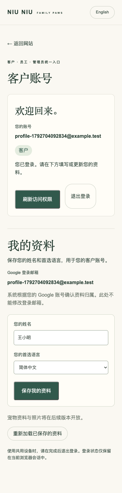

# Customer profile registration — delivered

Live: https://niu-niu-family-paws.web.app/#/login. [PR #10](https://github.com/Fifiloveniuniu/niu-niu-family-paws/pull/10) merged as `12df8c3e238ca8197a3c50f4db8290ca87db9f3e`, then Firebase Hosting deployed and pinned the new backend revision. See [release notes](release-4.md).

Scope: a verified Google user can create/read/edit their own name and preferred language. Administrators and staff can use the same personal profile panel while retaining their existing roles. Pets/photos, role management, impersonation, and linking existing administrator-created records are separate features.

`GET /api/profile` returns the current identity's canonical customer record (204 when none exists). `PUT /api/profile` accepts only name, language, and record version. The backend derives UID and verified Google email from the checked Firebase account/token, rejects disabled/unverified/non-Google sessions and client-selected owners, and never grants a role. Direct browser Firestore access remains denied.

The internal `people/{uid}` record stores only a reference to one canonical `customers/{uuid}` document. Creating both is transactional; simultaneous requests and uncertain-save retries cannot create multiple profiles. Existing records are never claimed or merged by matching name/contact email. Administrator edits preserve protected ownership and verified-email metadata. Customer edits preserve administrator-managed contact fields. Shared versions prevent stale edits, and the same customer history records the actual actor for both workflows. Current verified login email is server-maintained and refreshed on profile reads with an audit entry if it changes; administrators can search its prefix.

Local validation passed: frontend build, API TypeScript, seven unit tests, two Firestore emulator integration cases, and five browser tests. Checks include owner/role injection, unverified/non-Google/disabled sessions, concurrent registration, retry safety, canonical shared data, stale edits, email refresh, corrupt-reference ownership denial, lost-response retry, sign-out isolation, preserved edits during access refresh, and the 400px Chinese layout. Browser API responses are mocked; Firestore logic is independently exercised against an isolated demo database.

Cloud Build `b3255756-9a41-4ce4-9da7-b3756c2f1e23` produced digest `sha256:8c3700d8c9b80335016b1cb246c0d0867542997afbf092cd6312c70849ea697d` from API source `1eea684`. It is deployed as Cloud Run revision `family-paws-api-00002-6x6`. Firebase Hosting now pins its API rewrite to this revision.

Real premerge verification passed with an ordinary verified Google account: registration, edit, reload, sign-out isolation, one canonical mapping/customer, and two self audit entries. An administrator then found that same record by verified Google-email prefix and edited it; the existing owner and login email were preserved, version advanced to 3, and the audit identified the actual administrator. The administrator's own profile remained empty and separate. Missing/invalid API tokens return 401.

After deployment, the live administrator saved and edited their own profile without losing the administrator role; the directory showed the same canonical record automatically. Google-email search, persisted name/language after reload, Chinese language persistence, and the 400px layout passed. Hosted HTML matches the build, and both profile/customer endpoints reject missing/invalid tokens with 401 and `private, no-store`. Direct identity-map access without authorization returns 403. No application-origin console errors were observed (one unrelated browser-extension error was present).

The two synthetic profiles, two UID mappings, and five synthetic audit entries were removed with identity/name/version checks and atomic update-time preconditions. Google/Firebase login accounts and real customer records were preserved. The local preview server/tab were stopped/closed, and the live browser viewport/language were restored.

Rollback note: registered profiles require a metadata-preserving API at or after `1eea684`. Do not roll back Hosting to an older API revision whose administrator writes replace entire customer documents; that could discard ownership/login metadata. Older frontend payloads remain compatible with the new API.

