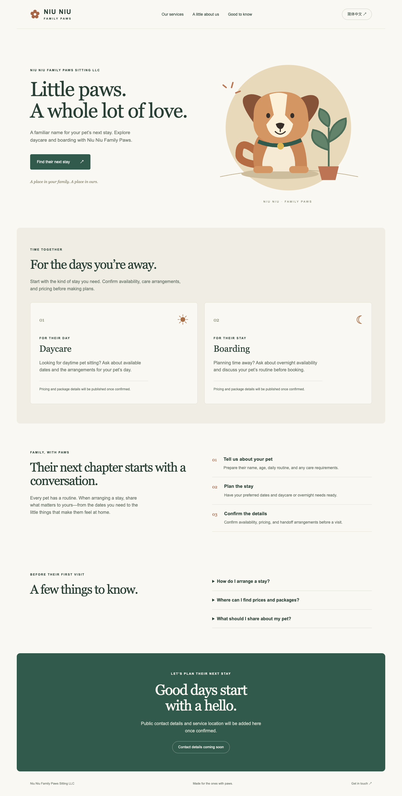
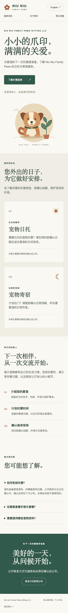

# Release 1: public website

Status: deployed and verified at https://niu-niu-family-paws.web.app. Business contact details, prices, and photos remain pending owner input; the site currently provides service information and FAQs without bookings.

Deployment target: Google Cloud project `niu-niu-family-paws`, number `775511787236`. Firebase terms accepted with explicit owner authorization. Firebase enabled with optional Google Analytics disabled.

An unused Google Cloud project `niu-niu-family-paws-web` was created during setup before the original project number was supplied. It is not the deployment target and has no website deployed. Do not delete it without authorization.

## Implemented

- React/TypeScript website with English and Simplified Chinese via react-i18next.
- Persistent language preference, in-page navigation, and native FAQ disclosures.
- Responsive service information and original dog illustration.
- Firebase Hosting configuration for `niu-niu-family-paws` with security headers.
- No sign-in links, booking forms, invented contact information, or unimplemented portal navigation.

## Verified

- `npm run build`: TypeScript validation and production bundle passed.
- `npm audit --omit=dev`: zero known production dependency vulnerabilities.
- Chrome production preview: English-to-Chinese switching, refresh persistence, FAQ expansion, and section navigation passed.
- Visual review: desktop and 400px mobile Chinese layout.
- Hosted verification: HTTPS 200, security headers, English/Chinese switching, FAQ navigation, and disclosure expansion passed.
- Public content is prerendered at build time for discoverability, then hydrated for language switching.

## Remaining

- Confirm business contact details, service location, prices, package terms, and photos. Current copy identifies these as pending; it does not accept bookings.

Future releases must preserve a working hosted site. Do not count a local build as feature delivery.

## Review screenshots

