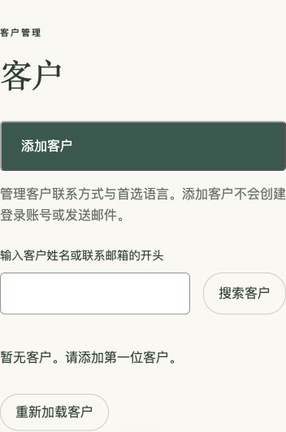

# Release 3 — administrator customer contacts

Live: https://niu-niu-family-paws.web.app/#/login

Delivered through [PR #5](https://github.com/Fifiloveniuniu/niu-niu-family-paws/pull/5), merged as `065b09d06c059e63a2f68c660ceeb8796637f703`, then deployed to Firebase Hosting.

Administrators can add/edit customer names, optional contact email/phone, and preferred English/Simplified Chinese language. Search matches the beginning of a name or contact email. Adding a customer does not create a login, link an account, or send email. Verified Google login search, pets, and customer self-registration remain separate future features.

Customer data is saved by a Fastify API on Cloud Run to Firestore in the owner-approved Oregon region. Every operation verifies the token and current administrator account status. Browser database access is denied. Version checks prevent stale edits; retry-safe saves avoid duplicate history. Audits identify the actual administrator and retain before/after values.

Validation passed for the frontend build, API TypeScript, five unit tests, database emulator integration, four emulator browser tests, and GitHub CI. Real administrator sign-in and create/edit/search/reload were verified first in a local production preview against the deployed API, then through the live Hosting rewrite. Both real edit histories were verified. Missing/invalid tokens return 401, anonymous database reads return 403, and customer responses are never cached. English/Chinese switching, Chinese persistence after refresh, 400px layout, one public login link, navigation, and FAQ expansion passed; no browser errors were observed. Hosted HTML matches the released build and retains security headers and HTML revalidation.

Two clearly marked synthetic customers and their four synthetic audit entries were removed after verification. No real customer information was used or deleted.

Billing is enabled. Cloud Run scales from zero to two instances with request-based CPU billing. Runtime/build identities have separate scoped permissions, and no service-account keys were created. Automatic request URL logging is excluded to keep search details out of stored logs. Scheduled backups/exports and the business recovery/retention policy remain undecided; customer/audit records have no automatic deletion. Infrastructure details are in [the customer-management document](customer-management-draft.md).

