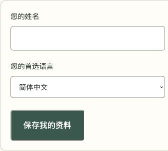

# Release 4 — Google customer profiles

Live: https://niu-niu-family-paws.web.app/#/login

Delivered through [PR #10](https://github.com/Fifiloveniuniu/niu-niu-family-paws/pull/10), merged as `12df8c3e238ca8197a3c50f4db8290ca87db9f3e`, then deployed to Firebase Hosting on 2026-10-22. The Cloud Run API remains in Oregon and Hosting pins revision `family-paws-api-00002-6x6`.

Google users can save/update their own name and preferred language. Administrators and staff can use the same personal profile panel without giving up existing roles or creating another person record. A UID mapping references one canonical customer document, shared with the administrator directory. Administrators can search the beginning of a verified Google email, shown separately from editable contact email.

The server derives identity/ownership from the verified token and current Firebase account. Disabled, unverified, and non-Google sessions cannot use profile endpoints. Clients cannot select another owner or change roles, balances, login email, or account linking. Transactional registration, shared versions, retry-safe saves, and before/after audits protect concurrent edits and uncertain responses. Existing contacts are not automatically claimed or merged by name/email. Pet profiles/photos, old-record linking, and impersonation remain future features.

Validation: frontend build, API TypeScript, seven unit tests, two Firestore integration cases, five emulator browser tests, and PR CI passed. Real ordinary Google sign-in verified registration/edit/reload/sign-out against the deployed API from a local production preview. An administrator searched that same record by verified email and edited it while preserving ownership, with the correct actual actor audited. On the live website, the administrator registered/edited their own profile, retained their administrator role, and saw that same record in the directory. English/Chinese and desktop/400px layouts, persisted name/language, and Google-email search passed. Hosted HTML matches the build and retains its security/cache headers. Missing/invalid tokens return 401 with no-store; anonymous identity-map reads return 403. No application-origin console errors were observed.

Two synthetic customer profiles, two identity mappings, and five test audit entries were removed. Login accounts and real customer records were preserved. Preview processes were stopped; the live page remains open. Recovery/backup decisions remain as documented in the handoff. See [profile technical details and rollback boundary](customer-profile.md).

